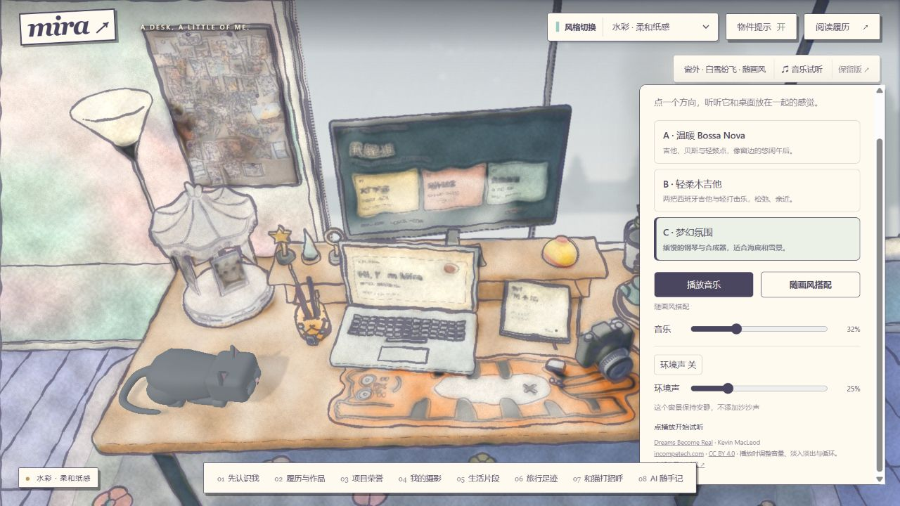

# Mira · 窗边工位

一个从真实书桌出发的个人作品集。点开电脑、相机、旋转木马、钱包和手写笔记本，认识 Mira 的工作与生活。



## 本地运行

需要 Node.js 20 或以上版本；网页运行不需要安装依赖。

```sh
npm start
```

打开 http://127.0.0.1:4175/ 。`site/` 是可独立托管的静态网站；本地服务仅监听本机。公开仓库不等于已经部署网站。

```sh
npm test
```

## 当前功能

- 11 种画风，共用一套桌面布局与内容入口；点击黄红小铃切换风格，并播放真实按铃录音。
- 画风固定搭配窗景：原版／漫画／素描 → 夕阳；黑白／朋克 → 暴雨；波普／像素 → 彩虹；动画／霓虹 → 海底；水彩／墨绘 → 雪景。
- 水波纹风格转场、雾玻璃窗景、旋转木马缓慢转动后打开生活照片。
- 实时 3D 小猫：平时趴卧，碰触后起身舔毛，再慢慢趴下；支持键盘和触屏触发。
- 简介、履历、项目荣誉、摄影、生活、旅行和 AI 随手记八个入口。
- 三种音乐试听：温暖 Bossa Nova、轻柔木吉他、梦幻氛围。可固定曲目或随画风搭配，换曲交叉淡入淡出，音乐与环境声独立控制，默认不自动播放。
- 摄影页面可临时选择本机照片预览，不会上传文件，刷新后清空。
- 保留早期版本与布局实验，主入口始终为 `site/index.html`。

部分奖项名称、生活照片、旅行记录和社媒账号仍是明确标记的占位内容。猫的造型与动作已接入，真实美短花色尚未制作。

## 目录与修改

| 路径 | 内容 |
| --- | --- |
| `site/content.js` | 简介、履历、相册、旅行与笔记内容 |
| `site/styles.js`、`site/style-window.js` | 画风与固定窗景映射 |
| `site/music.js`、`site/window-audio.js` | 背景音乐与可选的合成环境声 |
| `site/home-cat.js`、`site/cat-local-motion.js` | 首页小猫与动作状态 |
| `site/assets/` | 网站所需的渲染图、模型、动画图集和声音 |
| `site/preserved-b/`、`site/preserved-window/` | 已保留的早期版本 |
| `blender/` | 建模、材质、渲染与动画制作源码 |
| `tests/` | 内容、资源、异步切换、动画和音乐回归检查 |

网站采用 Blender 预渲染房间、画布窗景和 Three.js 实时小猫的组合。运行与部署使用仓库内现成资源，不需要 Blender。`blender/build_mira_block_cat.py` 可通过 Blender 独立重建小猫；整个房间重渲染还需要本地制作工程中的参考纹理与渲染通道，这些大型中间产物、原始简历及原始视频不在本公开仓库中。`blender/` 中部分制图脚本使用 Windows 字体路径，跨平台使用时需替换。

## 来源与使用说明

视觉与固定场景方案参考 [Evan Lin 的 personal-website](https://github.com/EdwinjJ1/personal-website)。复用与修改的建模／渲染工具保留其 MIT 声明：[LICENSE.upstream](LICENSE.upstream)。Three.js 的 MIT 许可位于 [site/vendor/three/LICENSE](site/vendor/three/LICENSE)。

三首音乐由 Kevin MacLeod 创作，来自 incompetech.com，依据 CC BY 4.0 使用。作者、来源与处理方式见 [音乐署名页](site/assets/audio/music/credits.html)。原作者猫模型的历史实验资源及署名见 [猫模型来源](site/assets/cat-library/CREDITS.txt)；当前首页使用独立制作的本地模型。

本仓库公开展示不代表所有内容都授予开源许可。Mira 的个人照片、个人资料、声音、原创设计与素材的使用说明见 [NOTICE.md](NOTICE.md)。本仓库不包含小野丽莎或《Loving Stranger》的音乐录音。
